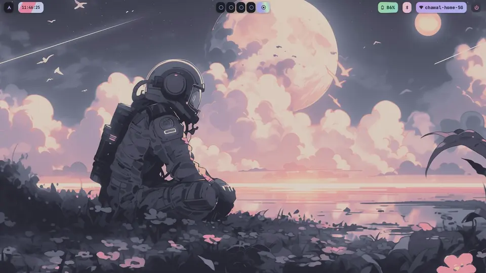

# chawal

My Hyprland rice: Arch Linux, Hyprland 0.56 with the Lua config, Catppuccin
Mocha and Latte switched live with one click. Linked into `$HOME` with GNU Stow.

[](assets/chawal.mp4)

A 31-second tour with sound: [`assets/chawal.mp4`](assets/chawal.mp4) (the
animation above is the same cut, silent). Real screen recordings; the Wi-Fi
name, battery level and fastfetch user line are stand-ins.

## What's in it

| Part | Tool |
|---|---|
| Compositor, lock, idle | Hyprland (Lua config), hyprlock, hypridle |
| Bar | Waybar |
| Quick settings, edge gauges | eww |
| Notifications | swaync |
| Launcher and control hub | rofi: apps, windows, clipboard; Wi-Fi and Bluetooth windows |
| Power menu | wlogout |
| Terminal | Alacritty, tmux, starship |
| Browser | Firefox with FF Ultima and a glass overlay (`firefox/`), the page colour (ATBC) only tints |
| Theme | Catppuccin Mocha / Latte across Hyprland, the bar, panels, rofi, terminals, GTK, Qt and KDE |
| Font | JetBrainsMono Nerd Font |

## Install

The repo must live at `~/dotfiles`: Stow makes relative links, and `stow.sh`
only accepts those.

```sh
git clone https://github.com/anubhab7111/chawal ~/dotfiles
cd ~/dotfiles
sudo pacman -S --needed stow          # then the packages below
./stow.sh                             # link every package into $HOME
sudo ./system/install.sh              # dual-GPU udev rule; skip on other hardware
./firefox/install.sh                  # Firefox rice; needs FF Ultima in the profile (docs/details.md)
~/.config/rice/bin/rice-theme bootstrap
systemctl --user daemon-reload        # loads the swaync drop-in
```

Log out and back in.

- `stow.sh` moves any real file in the way to `~/.dotfiles-backup/<timestamp>/`
  and never deletes it. Running it again is safe.
- `system/install.sh` is only for the dual-GPU laptop this was built on. On
  other hardware, also drop the `AQ_DRM_DEVICES` line from
  `config-hypr/.config/hypr/modules/env.lua`.
- A few files hard-code `/home/ushtro/`. For another user name, replace that
  prefix in the files `grep -rl /home/ushtro config-* home-*` lists.

## Packages

`(AUR)` packages come from the AUR.

| Area | Packages |
|---|---|
| Compositor | `hyprland` `hyprlock` `hypridle` `hyprsunset` `hyprshot` `hyprpicker` `xdg-desktop-portal-hyprland` `polkit-kde-agent` |
| Bar, widgets | `waybar-git` (AUR; the 0.15.0 release breaks on the Lua config) `eww` (AUR) `swaync` |
| Launchers, wallpaper | `rofi` `awww` `mpvpaper` `cliphist` `wl-clipboard` `imv` |
| Terminal, shell | `alacritty` `tmux` `yazi` `btop` `cava` `fastfetch` `starship` `neovim` |
| Audio, media | `pamixer` `playerctl` `pwvucontrol` (AUR) `brightnessctl` |
| Network, Bluetooth | `networkmanager` `network-manager-applet` `iw` `bluez` `bluez-utils` `blueman` |
| Capture | `grim` `slurp` `wf-recorder` |
| Power, night light | `wlogout` `tlp` `tlp-pd` (enable `tlp.service`) `batsignal` `darkman` |
| Theming | `qt6ct` `kvantum` `kvantum-theme-catppuccin-git` (AUR) `catppuccin-gtk-theme-mocha` `catppuccin-gtk-theme-latte` (AUR) `bibata-cursor-theme` (AUR) `nwg-look` `ttf-jetbrains-mono-nerd` |
| Icons | `candy-icons`, installed by hand into `~/.local/share/icons/` |

The apps the binds start (Thunar, Firefox, VSCodium, …) are set at the top of
`config-hypr/.config/hypr/modules/binds.lua`.

## Keybinds

| Keys | Action |
|---|---|
| `SUPER+SPACE` | rofi hub: apps, windows, clipboard |
| `SUPER+N`, top-right corner | quick settings |
| `SUPER+W` | wallpaper grid |
| `SUPER+Esc` | power menu |
| `SUPER+L` | lock |
| `SUPER+Q` / `SUPER+C` | terminal / close window |
| `SUPER+1…0` / `SUPER+SHIFT+1…0` | go to / move to workspace |
| `SUPER+grave` / `SUPER+S` | drop-down terminal / magic scratchpad |
| `Print` / `SHIFT+Print` | screenshot screen / region |

Touching the right edge slides out the brightness, volume and mic gauges.
All binds are in [the details](docs/details.md#keybinds).

## Themes

`rice-theme toggle`, or the Theme control in quick settings, switches between
Mocha and Latte everywhere at once; `rice-theme apply mocha|latte` picks one.
Nothing tracked in git changes: the active theme lives in `~/.local/state/rice`
and in gitignored slot links, so `git status` stays clean.

## Layout

Each `config-*` directory is a Stow package for one directory in `~/.config`;
each `home-*` holds one dotfile or directory directly under `$HOME`.

- `config-hypr` holds Hyprland (`hyprland.lua` plus `modules/`), hyprlock and
  hypridle.
- `config-rice` holds the `rice-*` scripts (`~/.config/rice/bin`).
- `config-theming` holds the Mocha and Latte themes.
- `config-eww`, `config-waybar`, `config-swaync`, `config-rofi` and
  `config-wlogout` hold the panels, the bar, notifications, the hub and the
  power menu.
- `system/` holds the files that need root. It is never linked into `$HOME`.
- `tests/` holds shell tests for the hub and quick settings; `tools/` holds the
  wlogout icon generator.

## Troubleshooting

- **No colours or an unstyled bar:** run `rice-theme bootstrap`, then
  `rice-theme apply`.
- **Lua config error:** Hyprland starts with emergency binds (`SUPER+Q`
  terminal, `SUPER+M` exit) and shows the error. Fix it and run `hyprctl reload`.
- **No eww panel or gauges:** run `pkill -x eww; eww daemon`.

How it all works (theme slots, the rofi hub, quick settings, swaync blur,
suspend on NVIDIA) is in [docs/details.md](docs/details.md).
